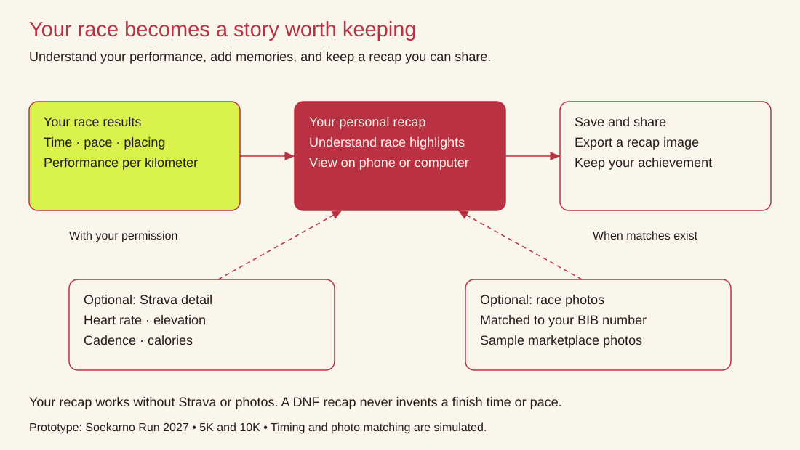
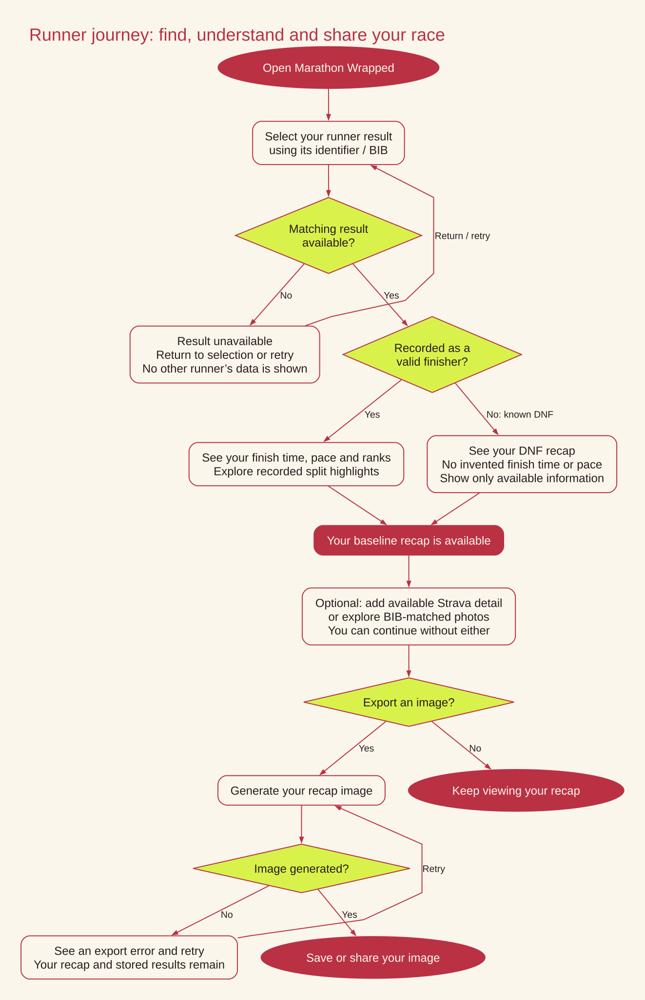
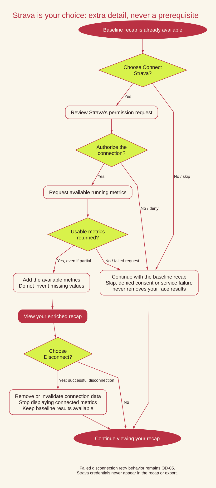
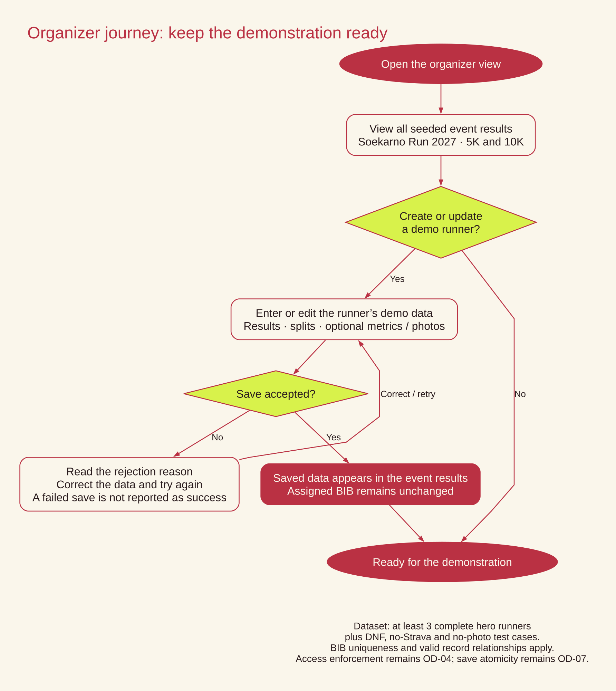
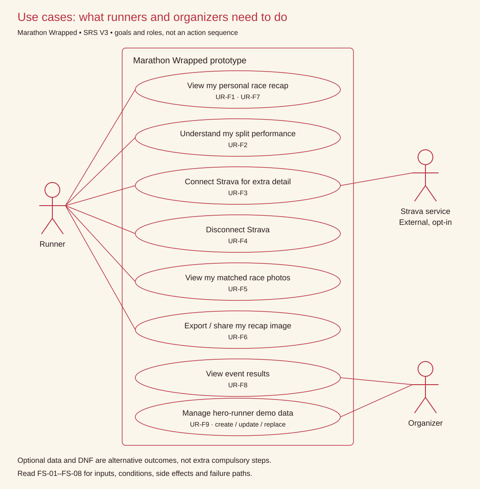
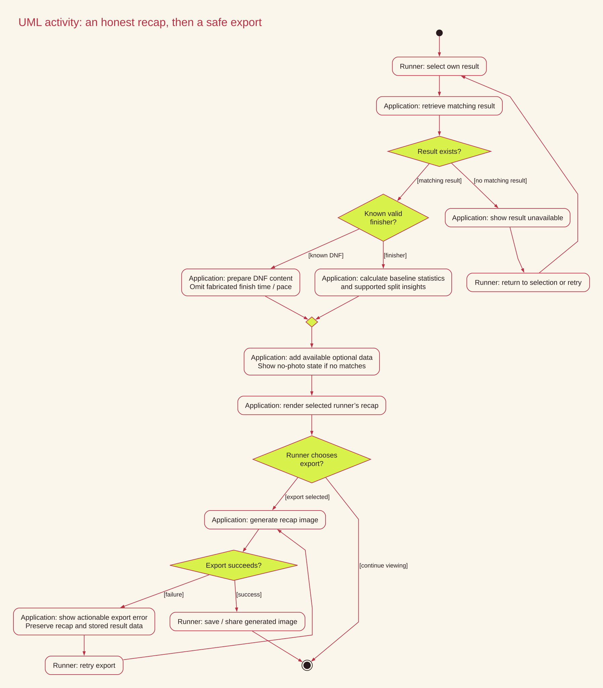
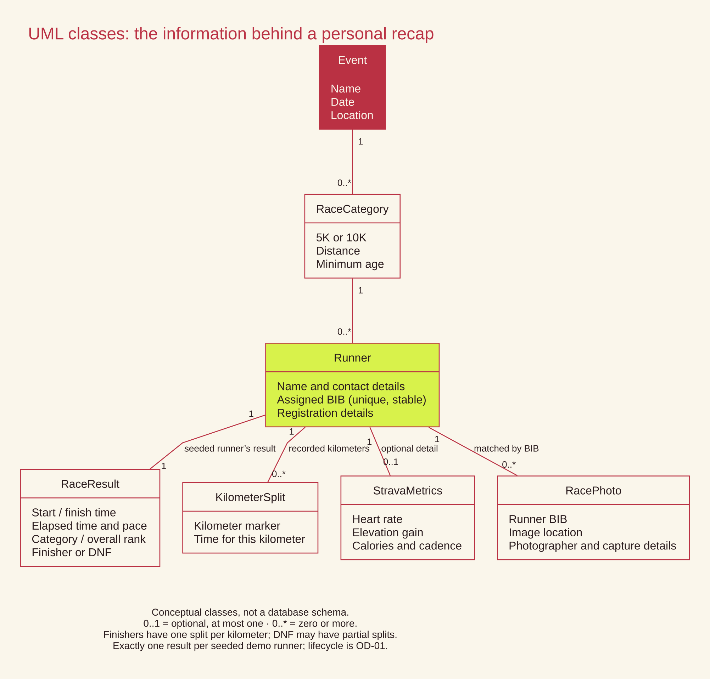
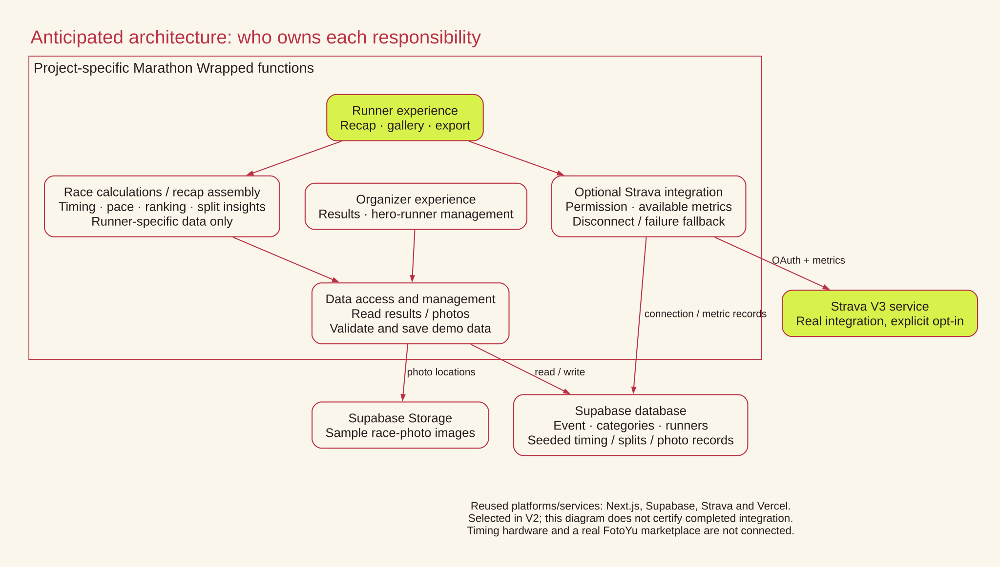

# Software Requirements Specification (SRS)

## Marathon Wrapped

**Course:** Software Engineering — Sampoerna University × University of Arizona

**Demo Scenario:** Soekarno Run 2027

**Version:** 3.0 (SRS V3)

**Date:** October 1, 2026

---

# Document control

| Field | Value |
| --- | --- |
| Document | Marathon Wrapped — SRS V3 |
| Baseline | [SRS_v2.md](https://github.com/marathon-management-system-softeng26/Marathon-Wrapped/blob/main/docs/SRS_v2.md), internal version 1.1, September 29, 2026 |
| Revision | October 1, 2026 |
| Status | Revised specification for team review; unresolved decisions are listed in section 11 |
| Editorial basis | Lecturer reference slides supplied by Bella: natural-language specification (slide 20), structured/form-based specification (slide 21), readable/precise requirements (slide 17), document structure (slide 24), validation (slide 25), live notes on IDs and change |
| Visual identity | Approved current Soekarno Run project palette: red `#BA3143`, cream `#FAF6EB`, lime `#D8F24B`; dark text `#291B1D` |

## How to read this document

**Shall** means mandatory; **should** means desirable. Optional runner choices, such as connecting Strava, still require mandatory application support.

User requirements are in section 4; system requirements in section 5; function specifications in section 6; traceability in section 7.

### Visual overview

### Runner journey

### Version history

| Version / file | Date | Reason and main changes |
| --- | --- | --- |
| 1.0 / SRS.md | September 24, 2026 | Original prototype scope, data model and functional/quality requirements. |
| 1.1 / SRS_v2.md | September 29, 2026 | Separate user/system requirements; measurable acceptance and traceability. |
| 3.0 / SRS_v3.md | October 1, 2026 | Lecturer-guided clarity, rationale, structured forms, branded diagrams, validation and controlled-change records. File sequence is V3; the baseline’s internal number was 1.1. |

## 1. Introduction

### 1.1 Purpose

This document specifies the requirements for **Marathon Wrapped**, a prototype web application that generates a personal, shareable, Spotify-Wrapped-style race recap for each runner in the **Soekarno Run** marathon event. It is intended for the project team, including development, QA, and documentation teams, as well as for course evaluation.

### 1.2 Scope

Marathon Wrapped provides every registered runner with a personalized recap card generated from baseline timing-chip data, including finish time, pace, category rank, and split performance. Runners who want a richer recap can optionally connect **Strava** to enrich their card with health metrics such as heart rate, elevation, cadence, and calories. Race photos are surfaced through a simulated **FotoYu**-style photo marketplace and matched to runners using their bib numbers. Runners can export and share their completed recap card as an image.

This is a **prototype**, not a production system:

- Timing-chip data is **seeded** and is not read from real race-day hardware.
- FotoYu is **simulated**; sample photos are manually mapped to bib numbers, and no facial recognition is implemented.
- Strava integration uses the **real, free-tier Strava V3 API**.
- The deliverable consists of a working prototype, a live demo, and this documentation; it is not intended to be a deployed production service.

### 1.2.1 Need and project objective

Runners need an understandable race memory instead of a set of disconnected statistics. The prototype turns seeded results into a personal story that can be saved as an image. Organizers need a reliable demonstration dataset and a view of event results. The course project’s objective is to demonstrate this experience within the agreed budget and schedule, while keeping timing and photo simulation visibly distinct from the real, voluntary Strava integration.

### 1.3 Intended Audience

The intended audience includes project team members (PM, database, logic, UI/UX, content/docs, and QA), course instructors, and graders.

### 1.4 Definitions

| Term | Meaning |
| --- | --- |
| Wrapped | The personalized recap card and experience generated for each runner |
| Chip result | Baseline timing data obtained from the simulated bib chip |
| FotoYu | Simulated race-photo marketplace with photos mapped to bib numbers |
| Hero runner | A seeded runner with complete, rich data used for demonstration purposes |
| DNF | Did Not Finish |
| User requirement | A requirement describing what a user needs the system to do or the quality of the experience |
| System requirement | A technical, testable requirement describing how the software shall implement a user requirement |

---

## 2. Overall Description

### 2.1 Product Perspective

Marathon Wrapped is a standalone web application that is not integrated with a live race-timing system. It is demonstrated using a simulated event, Soekarno Run 2027, with two race categories: 5K and 10K.

### 2.2 Product Functions

The system shall:

- Generate a personalized Wrapped card from chip timing data for every runner.
- Allow a runner to optionally connect their Strava account for additional data.
- Surface race photos matched to the runner's bib number through a simulated FotoYu marketplace.
- Allow a runner to export and share their Wrapped card as an image.
- Allow an organizer to view runner results and manage seeded hero runners within the prototype scope.

### 2.3 User Classes

| User | Description |
| --- | --- |
| Runner | Registered participant who can view their own Wrapped and optionally connect Strava |
| Organizer | User who can view aggregate data and manage seeded events, categories, and hero runners within the prototype scope |

### 2.4 Operating Environment

The application is a web application built with a Next.js frontend and backend, a Supabase database, and Vercel hosting. It runs in modern web browsers and supports both desktop and mobile screen widths.

### 2.5 Design & Implementation Constraints

- The project uses low-budget, free-tier tooling only, including the Supabase free tier, Vercel free tier, and Strava free API tier.
- The system does not include a real payment gateway, real RFID/chip hardware, or facial recognition.
- The prototype is limited to a single event, **Soekarno Run 2027**, with two categories: 5K and 10K.

### 2.6 Assumptions & Dependencies

- Strava's free-tier API remains available and within its applicable rate limits throughout the demo.
- Sample/seed data is used as a substitute for real race-day data capture.
- Hero runners are pre-seeded with complete data to ensure a reliable live demonstration.

---

## 3. Data Requirements

### 3.1 Runner Registration Data

| Field | Type | Notes |
| --- | --- | --- |
| Full legal name | text | Must match the runner's ID; immutable after registration closes |
| Date of birth | date | Used to calculate age and determine category eligibility |
| Gender | enum (M/F) | Immutable after registration closes |
| Email address | text | Used for registration confirmation |
| Phone number | text | Used for contact |
| ID type | enum | KTP, SIM, Passport, KK, KITAS, or Student ID |
| ID number | text | Verified against the selected ID type during race pack collection |
| Race category | enum | 5K or 10K |
| Jersey size | enum | S–XXL; immutable after registration closes |
| Parental consent | boolean/file | Required if the runner is under 17 |
| BIB number | text (unique) | Assigned after registration and is non-transferable |

**Age eligibility:**

- 5K: minimum age 13
- 10K: minimum age 17

### 3.2 Baseline / Optional Data

| Data Type | Source | Required? |
| --- | --- | --- |
| Chip timing (start, finish, splits) | Simulated bib chip | Required for every finisher |
| Strava metrics (HR, elevation, cadence, calories) | Strava V3 API (opt-in) | Optional |
| FotoYu photos | Simulated marketplace, mapped by bib number | Optional |

### 3.3 Entity Overview

- **events** — event_id, name, event_date, location
- **categories** — category_id, event_id (FK), name (5K/10K), distance_km, min_age
- **runners** — runner_id, category_id (FK), bib_number (unique), name, gender, date_of_birth, id_type, id_number, email, phone
- **chip_results** — result_id, runner_id (FK, unique), start_time, finish_time, elapsed_seconds, avg_pace_sec_km, category_rank, overall_rank, finisher (bool)
- **chip_splits** — split_id, runner_id (FK), km_marker, split_seconds
- **strava_metrics** — metric_id, runner_id (FK, unique), avg_heartrate, max_heartrate, elevation_gain_m, calories, avg_cadence
- **fotoyu_photos** — photo_id, bib_number (FK), photo_url, photographer, captured_km, captured_at

### 3.4 Relationships — conceptual model

- One **event** → many **categories** (1:N)
- One **category** → many **runners** (1:N)
- One **runner** → exactly one **chip_results** record (1:1)
- One **runner** → many **chip_splits** records, one per kilometer (1:N)
- One **runner** → zero or one **strava_metrics** record (1:0..1, optional)
- One **runner**, identified via bib_number → zero or many **fotoyu_photos** records (1:0..N, optional)

Exactly one result is expected per seeded demo runner. The database permits at most one result per runner; result lifecycle and DNS behavior remain OD-01. Physical field names are defined in `supabase/migrations/20261019155810_initial_schema.sql`.

---

# 4. User requirements

Module ownership and parent/child ID mapping are recorded in the [requirement register](requirements-register.md). New rows can be grouped by module without changing existing IDs.

## 4.1 Mandatory functional requirements

| ID | Requirement | Rationale | Verification / acceptance measure |
| --- | --- | --- | --- |
| **UR-F1** | A runner **shall** be able to view a personalized Wrapped containing their finish time, average pace, category rank, overall rank, and split information. | Runners need one reliable summary of their race without interpreting raw timing records. | For every seeded finisher, all 5 baseline information types are displayed on the runner's Wrapped. |
| **UR-F2** | A runner **shall** be able to view split-based performance insights. | A runner needs to understand how their performance changed during the race. | The Wrapped displays at least the fastest kilometer and whether the runner's later splits were faster or slower than earlier splits. |
| **UR-F3** | A runner **shall** be able to connect Strava voluntarily to enrich the Wrapped with available running metrics. | Extra running metrics should be available without making an external account a prerequisite. | After successful OAuth connection, the system displays available heart rate, elevation, calories, and cadence data; no Strava connection is required to view the baseline Wrapped. |
| **UR-F4** | A runner **shall** be able to disconnect Strava and continue using the baseline Wrapped. | Runners need control over the connection without losing their race results. | After disconnection, the baseline chip data remains viewable and Strava metrics are no longer displayed as connected data. |
| **UR-F5** | A runner **shall** be able to view race photos associated with their BIB number. | Runners need to find their own race memories without searching unrelated photos. | If matching photos exist, they are displayed in a gallery; if none exist, the Wrapped still opens and displays a no-photo state. |
| **UR-F6** | A runner **shall** be able to export and share their completed Wrapped as an image. | A portable image lets runners save and share their achievement. | A successful export produces an image file containing the personalized Wrapped card. |
| **UR-F7** | A runner with DNF status **shall** still be able to access a valid Wrapped experience without misleading finish-time information. | A runner who did not finish still deserves an accurate recap. | A DNF test record renders without an application error and does not display a fabricated finish time or pace. |
| **UR-F8** | An organizer **shall** be able to view runner results for the demonstration event. | Organizers need visibility into the demonstration event. | The organizer can access results for all seeded runners in the Soekarno Run 2027 dataset. |
| **UR-F9** | An organizer **shall** be able to manage the seeded hero runners used for demonstration. | The team needs repeatable demonstrations without editing application code. | The organizer can create, update, or replace hero-runner demonstration data without modifying the application's source code. |

## 4.2 Mandatory quality requirements

| ID | Requirement | Rationale | Verification / acceptance measure |
| --- | --- | --- | --- |
| **UR-NF1** | The Wrapped experience **shall** be usable on desktop and mobile screen widths. | Runners may open their recap on a phone or computer. | The core Wrapped view and export action remain usable at both desktop and mobile viewport sizes used in QA testing. |
| **UR-NF2** | The Wrapped **shall** remain usable when optional data is unavailable. | Optional services must not become prerequisites for the recap. | Removing Strava data or photo data from a test runner does not prevent the baseline Wrapped from rendering. |
| **UR-NF3** | The Wrapped **shall** provide a responsive experience with acceptable loading time. | Runners should not wait excessively for seeded results. | A seeded runner's Wrapped shall become usable within **3 seconds** on the agreed test connection and environment. |
| **UR-NF4** | Runner BIB information **shall** remain consistent and trustworthy. | Stable BIB identity keeps results and photos attached to the correct runner. | No two runners may have the same BIB number, and an assigned BIB number shall not change during normal runner-data updates. |
| **UR-NF5** | The prototype **shall** remain affordable to operate within the project constraints. | The course prototype must fit the agreed low-budget scope. | All required third-party services used for the prototype shall operate within their available free tiers during the demonstration period. |

## 4.3 Desirable presentation requirements — new in V3

These presentation recommendations do not replace mandatory requirements.

| ID | Requirement | Rationale | Verification / acceptance measure |
| --- | --- | --- | --- |
| **UR-D1** | The recap **should** explain pace, split, cadence and DNF in everyday words when those terms appear. | First-time runners may not know race-data vocabulary. | Review each term in the recap and confirm that an explanation is available without leaving the experience. |
| **UR-D2** | The recap **should** state that Strava adds optional detail and that the baseline recap is already available. | A runner should not mistake account connection for a compulsory step. | Review the connection prompt and confirm it communicates that the runner can continue without connecting. |
| **UR-D3** | The recap **should** use the approved Soekarno Run red, cream and lime visual identity. | Consistent presentation connects the recap to the event brand. | Compare the recap and new documentation assets with the approved palette; retain readable contrast. |

# 5. System requirements

Lettered clauses split independent obligations while retaining the original parent ID.

## 5.1 Mandatory functional requirements

| ID | Requirement | Rationale | Verification / acceptance measure |
| --- | --- | --- | --- |
| **SR-F1** | The system **shall** retrieve one `chip_results` record for each runner with a valid result. | One result must belong to the selected runner. | Retrieve the seeded result by runner identifier and verify the returned runner reference. |
| **SR-F2** | The system **shall** calculate `elapsed_seconds` as `finish_time - start_time` for a finisher. | Elapsed time must reflect time actually spent racing. | Compare a known start/finish pair with their difference in seconds. |
| **SR-F3** | The system **shall** calculate `avg_pace_sec_km` as `elapsed_seconds / distance_km`, using the runner's category distance. | Pace must use the selected race distance. | For a 10K finisher with 3,000 elapsed seconds, verify 300 seconds/km. |
| **SR-F4** | The system **shall** store one split record per kilometre marker for each seeded finisher. | Complete split data supports kilometer-by-kilometer insights. | For seeded 5K and 10K finishers, verify exactly one record for every marker from 1 through the category distance. |
| **SR-F5** | The system **shall** calculate category and overall rankings from finisher elapsed time in ascending order. | Rankings must be based on recorded performance. | Compare ranks with an ascending sort of valid finisher elapsed times; exclude DNF. Resolve tie policy and overall comparison scope in OD-02. |
| **SR-F6a** | The system **shall** mark a started runner as `finisher = false` when no valid finish time is available. | Missing finish data must never become an invented achievement. | Use a started runner with no valid finish time; verify finisher=false and no calculated finish pace. DNS handling remains OD-01. |
| **SR-F6b** | The system **shall** not calculate a finish pace for a runner marked `finisher = false`. | Missing finish data must never become an invented achievement. | Use a started runner with no valid finish time; verify finisher=false and no calculated finish pace. DNS handling remains OD-01. |
| **SR-F7** | The system **shall** generate split insights from the stored split records, including the fastest kilometre and a comparison of earlier versus later split performance. | Insights must be explainable from recorded splits. | Verify fastest kilometer against the minimum split; compare early/later performance using the rule approved under OD-03. |
| **SR-F8** | The system **shall** initiate Strava OAuth 2.0 only after the runner explicitly selects the connect action. | Account connection must be a deliberate runner choice. | Open the recap without selecting Connect; verify OAuth is not initiated. Select Connect and verify authorization begins. |
| **SR-F9** | For a successfully connected runner, the system **shall** retrieve the available Strava values for average heart rate, maximum heart rate, elevation gain, calories, and average cadence. | Only available values can be displayed honestly. | Connect a runner with all five values and another with missing values; verify available values are retrieved and absent values are not invented. |
| **SR-F10** | The system **shall** store at most one active `strava_metrics` record per runner. | Duplicate active metric sets could produce inconsistent displays. | Attempt to create a second active metrics record for the same runner; verify at most one is retained. |
| **SR-F11** | The system **shall** allow the runner to disconnect Strava and remove or invalidate the associated connection data. | Disconnect must end the association with connected data. | Disconnect, reload, and verify the connection data is removed or invalidated and metrics are no longer shown as connected. |
| **SR-F12** | A failed, unavailable, or incomplete Strava response **shall** not prevent baseline chip data from being rendered. | An enrichment failure must not block race results. | Test a denied request, unavailable service and incomplete response; verify the baseline still renders. |
| **SR-F13** | The system **shall** match FotoYu records to runners using the unique `bib_number`. | BIB identity is the agreed photo-matching method. | Query photos for a known BIB and verify all returned records match that BIB. |
| **SR-F14** | The system **shall** display all available photo records returned for the runner's BIB. | Runners should receive all photos available for their BIB. | Use a runner with multiple seeded photos; verify all matched records appear. |
| **SR-F15a** | When zero photo records are returned, the system **shall** display a no-photo state. | No photos is a valid outcome, not an application failure. | Use a runner with zero photos; verify a no-photo state and the rest of the recap. |
| **SR-F15b** | When zero photo records are returned, the system **shall** continue rendering the remainder of the Wrapped. | No photos is a valid outcome, not an application failure. | Use a runner with zero photos; verify a no-photo state and the rest of the recap. |
| **SR-F16** | The system **shall** combine chip data, calculated insights, optional Strava metrics, and optional photos into one runner-specific Wrapped view. | The recap needs one coherent view of the runner’s available data. | Compare the displayed timing, insights, metrics and photos with a complete hero-runner dataset. |
| **SR-F17** | The system **shall** generate the Wrapped using the runner's unique identifier/BIB and **shall** not mix data between runners. | A recap must never expose another runner’s result. | Alternate between two runners; verify every displayed result, metric and photo belongs to the selected identifier/BIB. |
| **SR-F18** | The export function **shall** generate an image containing the rendered Wrapped card for the selected runner. | Sharing requires a usable image of the selected recap. | Export two different runners and inspect the generated images for the correct runner and rendered recap. |
| **SR-F19a** | An export failure **shall** display an actionable error state. | A failed export must be recoverable without data loss. | Force an export failure; verify an actionable message and unchanged stored results. |
| **SR-F19b** | An export failure **shall** not remove or corrupt the runner’s stored result data. | A failed export must be recoverable without data loss. | Force an export failure; verify an actionable message and unchanged stored results. |
| **SR-F20** | The organizer view **shall** retrieve the runner results for the selected prototype event. | The organizer view must use the correct event dataset. | Load Soekarno Run 2027 organizer results and compare with all seeded event runners, including DNF. |
| **SR-F21** | The organizer **shall** be able to create or update seeded hero-runner data through the supported management interface. | The demonstration dataset must be manageable through the interface. | Create and update a hero runner using the supported organizer interface; verify persisted data without a source-code edit. |
| **SR-F22** | The system **shall** support at least **3 hero runners** with complete chip, Strava, and photo data for demonstration testing. | Several complete runners make the demonstration repeatable. | Verify at least three hero runners each have chip, Strava and photo data. |

### V3 clarifications

| ID | Requirement | Rationale | Verification / acceptance measure |
| --- | --- | --- | --- |
| **SR-F23** | When the supplied runner identifier or BIB has no matching runner result, the system **shall** display a result-unavailable state with an action to return to runner selection or retry. | A missing result must not be mistaken for another runner’s recap or fabricated data. | Request an unknown identifier; verify the message, return/retry action and absence of another runner’s data. |
| **SR-F24** | When a hero-runner save is rejected, the organizer interface **shall** show the rejection reason and allow correction before reporting success. | Organizers need to know whether demonstration data was saved. | Try a duplicate BIB or invalid relationship; verify no success message, a visible reason and a correction path. |

## 5.2 Mandatory quality requirements

| ID | Requirement | Rationale | Verification / acceptance measure |
| --- | --- | --- | --- |
| **SR-NF1** | For the agreed seeded dataset and test environment, the runner's Wrapped page **shall** reach a usable state within **3 seconds** for at least **95% of 20 consecutive page-load tests**. | A repeatable threshold makes loading quality testable. | Record the agreed dataset/environment; measure 20 consecutive loads and verify at least 19 reach a usable state within 3 seconds. |
| **SR-NF2** | The system **shall** not make unnecessary repeated requests for the same runner data during a single Wrapped page load. | Redundant requests consume time and free-tier allowances. | Inspect one page-load request trace; verify no redundant identical runner-data request without a documented reason. |
| **SR-NF3** | If Strava data is unavailable, the system **shall** still render the baseline Wrapped containing chip timing data and split insights. | Strava is enrichment, not the source of baseline results. | Remove Strava data or simulate unavailability; verify timing and available split insights render. |
| **SR-NF4** | If no photo records are available, the system **shall** still render the baseline Wrapped without a server or client-side application error. | Photos are optional memories, not a recap prerequisite. | Remove photo records and verify the baseline renders without an application error. |
| **SR-NF5a** | If a runner is marked DNF, the system **shall** render a valid DNF state. | DNF must be represented truthfully. | Use a DNF record; verify the status is visible and no fabricated finish time or pace appears. |
| **SR-NF5b** | If a runner is marked DNF, the system **shall** not calculate or display a fabricated finish time or pace. | DNF must be represented truthfully. | Use a DNF record; verify the status is visible and no fabricated finish time or pace appears. |
| **SR-NF6** | For each resilience test above, the system **shall** recover to a usable Wrapped view without requiring a page-wide application restart. | Core functionality must recover without restarting the whole application. | For missing Strava, missing photos and DNF, verify a usable recap without a page-wide restart. |
| **SR-NF7** | The project test suite **shall** include at least **one test case each** for missing Strava data, missing photo data, and DNF data. | Known failure paths need repeatable regression checks. | Review the project test suite for at least one test each covering missing Strava, missing photos and DNF. |
| **SR-NF8** | The database **shall** enforce `bib_number` uniqueness. | Duplicate BIBs would join data to the wrong runner. | Attempt duplicate BIB insertion and verify the database rejects it. |
| **SR-NF9** | The system **shall** prevent a normal runner update from changing an assigned `bib_number`. | Assigned BIBs must remain stable during ordinary edits. | Edit a runner normally; attempt a BIB change and verify it is prevented. |
| **SR-NF10** | Foreign-key relationships **shall** prevent orphaned chip-result, split, Strava, and photo records where the corresponding runner does not exist. | Dependent records must not survive without a corresponding runner. | Attempt orphan chip, split, metrics and photo records; verify the foreign-key constraints reject them. |
| **SR-NF11a** | A runner **shall** have no more than one `chip_results` record. | A runner must not have competing result or metric records. | Attempt duplicate runner references in results and metrics; verify uniqueness is enforced. |
| **SR-NF11b** | A runner **shall** have no more than one `strava_metrics` record. | A runner must not have competing result or metric records. | Attempt duplicate runner references in results and metrics; verify uniqueness is enforced. |
| **SR-NF12** | Strava connection **shall** require explicit user authorization through OAuth 2.0. | External data access requires the runner’s explicit consent. | Verify successful Strava connection requires the OAuth authorization step. |
| **SR-NF13** | Strava credentials or access tokens **shall** not be displayed in the runner-facing Wrapped. | Tokens are credentials, not recap content. | Inspect rendered runner-facing content and exported images; verify no credentials or access tokens are shown. |
| **SR-NF14** | Organizer-only functions **shall** not be exposed as runner functions in the application interface. | Runner and organizer responsibilities must stay distinct. | Inspect runner screens; verify organizer functions are not offered as runner actions. Authorization implementation is OD-04. |
| **SR-NF15** | The core Wrapped view **shall** be usable at both mobile and desktop viewport sizes supported by the project. | The core experience must work across supported screen sizes. | At the QA-recorded mobile and desktop viewport sizes, verify the core view can be read and used. |
| **SR-NF16** | The runner **shall** be able to reach the Wrapped, Strava connection action, photo gallery, and export action without requiring more than **3 navigation steps** from the relevant starting screen. | Key actions should be easy to reach. | From each QA-defined relevant starting screen, count transitions to recap, connect, gallery and export; verify no more than three each. |
| **SR-NF17** | The application **shall** support the modern desktop and mobile browsers selected by the QA team for the final demonstration. | Browser support needs an explicit acceptance baseline. | Record the modern desktop/mobile browsers chosen by QA; exercise the core journey in each. |
| **SR-NF18** | Required third-party services **shall** remain within their applicable free-tier limits during the project demonstration. | Required infrastructure must remain affordable. | Record free-tier allowances and expected demo usage; verify required services remain within them. |
| **SR-NF19** | The seeded dataset **shall** contain at least **3 complete hero runners** and **shall** include at least one test runner for each of the following edge cases: DNF, no Strava data, and no photo data. | Both success and edge cases must be demonstrable. | Audit the seed dataset: at least three complete hero runners and at least one case each for DNF, no Strava and no photos. |

## 5.3 Desirable presentation requirements — new in V3

| ID | Requirement | Rationale | Verification / acceptance measure |
| --- | --- | --- | --- |
| **SR-D1** | A skipped, denied or unavailable Strava connection **should** display a brief explanation that the baseline recap remains available. | A visible explanation helps the runner understand why optional detail is absent. | Exercise all three states and review the explanation; baseline rendering is separately mandatory under SR-F12 and SR-NF3. |
| **SR-D2** | Successful Strava disconnection **should** display a confirmation in the current recap view. | Confirmation helps runners understand that their choice took effect. | Disconnect a runner and review the confirmation; disconnection itself remains mandatory under SR-F11. |

# 6. Structured function specifications

The following forms define each function’s inputs, outputs, actions, conditions, side effects and exceptions.

## 6.1 FS-01 — Open a personal race recap

| Field | Specification |
| --- | --- |
| Definition | Display the selected runner’s race story using their available results. |
| Inputs | Runner identifier or BIB; event/category; chip result; recorded splits; optional metrics and matched photos. |
| Sources | Selected runner context; seeded database records; stored optional Strava metrics; simulated photo records matched by BIB. |
| Outputs | A finisher recap, a DNF recap, or a result-unavailable state. |
| Destinations | Runner-facing Wrapped view on desktop or mobile. |
| Information needed | Category distance; finish status; valid start/finish times; available split records; ownership of all returned records. |
| Action | Look up the selected runner. If their result exists, use FS-02 to determine baseline content. Add available optional metrics and photos. Display a no-photo state when none match. Do not combine data from different runners. |
| Preconditions | The prototype event and runner-selection context are available. No Strava connection or photo is required. |
| Postconditions | The displayed content belongs to the selected runner; missing optional data does not block the baseline recap. |
| Side effects | Read operations only; no result changes are needed to view a recap. Data-fetch policy follows SR-NF2. |
| Exceptions | Unknown runner or unavailable result: show return/retry action (SR-F23). DNF: use FS-02 without invented finish values. Missing Strava/photos: retain baseline. |
| Requirements | UR-F1, UR-F2, UR-F5, UR-F7; SR-F1, SR-F12–SR-F17, SR-F23; SR-NF3–SR-NF6. |

## 6.2 FS-02 — Calculate and explain baseline results

| Field | Specification |
| --- | --- |
| Definition | Convert seeded timing data into an accurate, understandable race summary. |
| Inputs | Start time; finish time; finisher flag; category distance; kilometer split times; valid event finisher results. |
| Sources | Chip result, category and split records in the seeded database. |
| Outputs | Elapsed time; average pace; category/overall ranks; fastest kilometer; early-versus-late performance insight, where data supports it. DNF status replaces finish claims for a non-finisher. |
| Destinations | Wrapped view and exported recap image. |
| Information needed | Time units; category distance; ranking comparison set; tie rule; early/later split comparison rule. OD-02 and OD-03 must be settled before final calculation acceptance. |
| Action | For a valid finisher, calculate elapsed seconds = finish − start and average pace = elapsed seconds ÷ distance in km. Sort valid finisher times ascending for ranking. Identify the minimum recorded split as the fastest kilometer. Apply the approved early/later comparison rule. |
| Preconditions | The selected runner and category are known; a finisher calculation requires valid timing data and a positive category distance. |
| Postconditions | Derived values can be traced to the selected runner’s recorded data. A DNF runner has no fabricated finish time or pace and is excluded from finisher rankings. |
| Side effects | Calculations may populate result fields as part of seeding/management; viewing a recap does not require altering the original timing records. The team must record where derived values are calculated or persisted. |
| Exceptions | For a started runner without a valid finish, show DNF and omit finish pace. Do not invent absent split measurements. Exact insufficient-split insight wording and tie handling remain OD-03. DNS and invalid-timestamp behavior remain OD-01. |
| Requirements | UR-F1, UR-F2, UR-F7; SR-F2–SR-F7; SR-NF5. |

## 6.3 FS-03 — Add optional Strava detail

| Field | Specification |
| --- | --- |
| Definition | Let a runner choose to add available running metrics from their Strava account. |
| Inputs | Connect selection; authorization outcome; available heart-rate, elevation, calorie and cadence values. |
| Sources | Runner action; Strava OAuth authorization and Strava V3 responses. |
| Outputs | A connected state and available metrics, or the baseline recap when connection/data is unavailable. |
| Destinations | The selected runner’s recap; at most one active stored metrics record for that runner. |
| Information needed | Runner identity; authorization outcome; which values were returned. Credentials remain outside runner-visible content. Activity matching is OD-05. |
| Action | Start OAuth only after Connect is selected. On authorization success, request available metrics and associate them with the selected runner. Display only available values. |
| Preconditions | A selected runner exists. Connection is voluntary; viewing the baseline does not require it. |
| Postconditions | With successful enrichment, available metrics belong to the selected runner. With denial, failure or incomplete data, the baseline remains usable. |
| Side effects | Authorized requests to Strava; storing or updating connection/metric data. Free-tier limits apply. |
| Exceptions | Skip or deny consent: remain with baseline. Request fails: baseline remains. Some values missing: do not fabricate them. Tokens must never appear in recap content or exports. |
| Requirements | UR-F3; SR-F8–SR-F10, SR-F12; SR-NF3, SR-NF12–SR-NF13; UR-D2, SR-D1. |

## 6.4 FS-04 — Disconnect Strava

| Field | Specification |
| --- | --- |
| Definition | Stop showing the runner’s Strava data as connected enrichment. |
| Inputs | Disconnect selection; selected runner’s connection information. |
| Sources | Runner action; stored connection/metric records. |
| Outputs | Disconnected state; baseline race recap. |
| Destinations | The selected runner’s recap and associated connection records. |
| Information needed | Which connection belongs to the selected runner; removal or invalidation policy. |
| Action | Remove or invalidate the associated connection data and stop presenting metrics as connected data. Keep baseline chip results available. |
| Preconditions | A selected runner has a connected Strava state. |
| Postconditions | A refreshed recap no longer presents Strava metrics as connected data; chip results remain available. |
| Side effects | Connection data is removed or invalidated; the retention details are OD-05. Chip results are not deleted. |
| Exceptions | Disconnection failure must not be presented as success; exact retry behavior is a design decision under OD-05. The existing baseline remains available. |
| Requirements | UR-F4; SR-F11–SR-F12; SR-D2. |

## 6.5 FS-05 — Show matched race photos

| Field | Specification |
| --- | --- |
| Definition | Show the race photos assigned to the selected runner’s BIB. |
| Inputs | Runner BIB; zero or more matching photo records. |
| Sources | Seeded FotoYu-style marketplace records and sample photo storage. |
| Outputs | Gallery of all matched photos, or a no-photo state. |
| Destinations | The selected runner’s recap/gallery. |
| Information needed | Unique BIB; photo URLs; photo attribution where stored. |
| Action | Match photo records by BIB and display all available matches. |
| Preconditions | The runner has an assigned BIB. Photos are optional. |
| Postconditions | Displayed photo records match the selected runner’s BIB; the baseline recap remains usable with no photos. |
| Side effects | Read photo records and retrieve image resources; no payment or facial recognition. |
| Exceptions | Zero matching records: display a no-photo state. Handling broken image URLs is OD-06; missing photo records are already covered by SR-F15. |
| Requirements | UR-F5; SR-F13–SR-F15; SR-NF4. |

## 6.6 FS-06 — Export and share a recap

| Field | Specification |
| --- | --- |
| Definition | Produce an image of the selected runner’s rendered recap for saving or sharing. |
| Inputs | Export selection; rendered recap for the selected runner. |
| Sources | Runner action and Wrapped view. |
| Outputs | Recap image file, or an actionable export error. |
| Destinations | Runner’s browser/download workflow; the runner may share the image using their chosen service. |
| Information needed | Selected runner identity; currently rendered recap; image-generation outcome. Exact format and dimensions are OD-06. |
| Action | Generate an image containing the selected runner’s rendered Wrapped. Report success only when generation succeeds. |
| Preconditions | A valid recap is rendered. Strava and photos are not prerequisites. |
| Postconditions | The image belongs to the selected runner; stored result data is unchanged by either success or failure. |
| Side effects | Create an image file. No automatic posting to a social platform is specified. |
| Exceptions | Image generation fails: show an action such as retrying export; retain the recap and original data. |
| Requirements | UR-F6; SR-F18–SR-F19; SR-NF13, SR-NF15–SR-NF17. |

## 6.7 FS-07 — View event results

| Field | Specification |
| --- | --- |
| Definition | Let the organizer inspect results for the demonstration event. |
| Inputs | Organizer context; selected prototype event. |
| Sources | Organizer interface and seeded event/runner/result records. |
| Outputs | Results for all seeded runners in Soekarno Run 2027. |
| Destinations | Organizer results view. |
| Information needed | Event identifier; runner categories; available results, including DNF status. |
| Action | Retrieve the selected event’s runner results and display them in the organizer view. |
| Preconditions | The organizer context is available; access/role enforcement is OD-04. |
| Postconditions | The organizer can inspect the complete seeded event dataset. |
| Side effects | Read only. |
| Exceptions | Missing/invalid event data must not be replaced with another event’s results. Exact organizer error wording remains a design decision. |
| Requirements | UR-F8; SR-F20; SR-NF14. |

## 6.8 FS-08 — Manage demonstration runners

| Field | Specification |
| --- | --- |
| Definition | Let the organizer create, update or replace hero-runner demonstration data through the supported interface. |
| Inputs | Selected event/category; runner details; result and split data; optional metrics and photos. |
| Sources | Organizer-entered demonstration data and existing seed records. |
| Outputs | Saved hero-runner data, or a rejected-save explanation with a correction path. |
| Destinations | Seeded database and organizer results view. |
| Information needed | Unique BIB; existing assigned BIB; valid record relationships; one result and at most one metrics record per runner. |
| Action | Create or update the selected runner and linked demonstration data. Preserve an assigned BIB during normal updates. Enforce uniqueness and relationships. Report success only after a successful save. |
| Preconditions | Organizer context and prototype event/category exist. |
| Postconditions | The supported interface can maintain at least three complete hero runners without source-code edits. The demo also includes DNF, no-Strava and no-photo cases. |
| Side effects | Insert or update runner and linked demonstration records. Sample Strava values for hero runners are demonstration data, not evidence of a live account authorization. |
| Exceptions | Duplicate BIB, orphaned relationship or failed save: show rejection reason and allow correction (SR-F24). Atomic multi-record save policy and replacement behavior are OD-07. |
| Requirements | UR-F9; SR-F21–SR-F22, SR-F24; SR-NF8–SR-NF11, SR-NF19. |

# 7. Models and requirements traceability

## 7.1 Use case diagram

## 7.2 UML activity diagram

## 7.3 UML class diagram

## 7.4 Traceability matrix

Parent IDs refer to all lettered clauses where a V2 requirement was split in V3.

| User requirement | Supporting system requirements | Function / visual |
| --- | --- | --- |
| UR-F1 | SR-F1–SR-F7, SR-F16–SR-F17 | FS-01, FS-02; runner flow, activity, class diagram |
| UR-F2 | SR-F4, SR-F7 | FS-02; runner flow |
| UR-F3 | SR-F8–SR-F10, SR-F12 | FS-03; Strava flow, use cases |
| UR-F4 | SR-F11–SR-F12 | FS-04; Strava flow, use cases |
| UR-F5 | SR-F13–SR-F15 | FS-05; overview, use cases |
| UR-F6 | SR-F18–SR-F19 | FS-06; runner flow, activity |
| UR-F7 | SR-F6, SR-NF5–SR-NF7 | FS-01, FS-02; runner flow, activity |
| UR-F8 | SR-F20 | FS-07; organizer flow, use cases |
| UR-F9 | SR-F21–SR-F22, SR-F24 | FS-08; organizer flow, use cases |
| UR-NF1 | SR-NF15–SR-NF17 | FS-01, FS-06; mobile/desktop QA |
| UR-NF2 | SR-F12, SR-F15, SR-NF3–SR-NF7 | FS-01, FS-03, FS-05; failure branches |
| UR-NF3 | SR-NF1–SR-NF2 | FS-01; 20-load performance check |
| UR-NF4 | SR-NF8–SR-NF11 | FS-05, FS-08; class diagram |
| UR-NF5 | SR-NF18–SR-NF19 | FS-03, FS-08; free-tier and seed audit |
| UR-F1 (missing-result clarification) | SR-F23 | FS-01; runner flow, activity |
| UR-D1 | Desirable presentation review | Glossary and recap wording review |
| UR-D2 | SR-D1 | FS-03; optional-enrichment wording |
| UR-D3 | Desirable brand review | All newly created/refined V3 assets |
| UR-F4 (desirable confirmation) | SR-D2 | FS-04 |

# 8. Technology, responsibilities and delivery schedule

## 8.1 Anticipated system architecture

The runner and organizer views share data access and recap calculations. Strava connection and metrics are optional additions. Next.js, Supabase, Strava and Vercel provide the selected framework, storage, external metrics and hosting.

## 8.2 Technology choices

| Layer | Choice |
| --- | --- |
| UI/UX design | Figma |
| Frontend | Next.js + Tailwind CSS |
| Backend | Next.js API routes |
| Database | Supabase (Postgres) |
| Photo storage | Supabase Storage |
| Optional enrichment | Strava V3 API |
| Hosting | Vercel |

## 8.3 Team responsibilities

| Member | Role | Owns |
| --- | --- | --- |
| Bella | PM | Requirements, scope, planning, demos, data contract, integration and risk log |
| Rakha | Database | Schema, seed data and hero runners |
| Embun | Logic | Recap calculations, rankings and merging chip/Strava/photo data |
| Indra | UI/UX | Recap experience, gallery and share/export |
| Harry | Content & Docs | Sample data, microcopy, SRS and report |
| Shaun | QA | Per-sprint testing and edge cases |

## 8.4 Delivery schedule — retained from V2

| Phase | Dates in 2026 | Goal |
| --- | --- | --- |
| Sprint 1 — Core | Sep 22–Oct 18 | Lock data contract; complete schema/seeds; render baseline cards |
| Sprint 2 — Polishing | Oct 19–Nov 13 | Integrate photos, Strava opt-in and export |
| Sprint 3 — Hardening | Nov 14–Dec 4 | Visual polish; hero runners; report draft |
| Project Closing | Dec 5–Dec 10 | Final fixes and rehearsal; report Dec 8; live demo Dec 10 |

# 9. Validation, acceptance and change management

## 9.1 Requirements validation

Review the specification using the lecturer’s five checks before claiming it represents agreed needs:

| Check | Review question | Evidence / follow-up |
| --- | --- | --- |
| Validity | Does each function support the runner’s or organizer’s real need? | Rationale plus stakeholder review; no approval inferred. |
| Consistency | Do statements, data rules, diagrams and roles agree? | Resolve OD-01 through OD-07; keep stable cross-references. |
| Completeness | Are all needed functions, qualities and alternative outcomes covered? | UR/SR-to-function/diagram mapping; no empty form fields. |
| Realism | Is the scope achievable with the available team, time, budget and technology? | Prototype/free-tier constraints and real Strava dependency checks. |
| Verifiability | Can each mandatory statement be checked objectively? | Verification column, fixtures, environment and expected results; resolve OD-08. |

Track IDs and changes in the [requirement register](requirements-register.md). Record reviews in the [validation record](SRS_VALIDATION.md) and follow the [documentation conventions](DOCUMENTATION_GUIDELINES.md).

## 9.2 Implementation acceptance evidence

| Review area | Evidence to record | Owner |
| --- | --- | --- |
| Baseline accuracy | Known-input calculations, displayed five baseline information types, split insights, runner isolation | Embun / Shaun |
| Voluntary Strava | Connect consent, available/incomplete metrics, failure fallback, disconnect and refreshed state | Embun / Shaun |
| Photos | BIB matching, multiple photos and no-photo outcome | Rakha / Indra / Shaun |
| Export | Inspect generated image for correct runner; exercise actionable failure and unchanged result data | Indra / Shaun |
| Organizer | View all seeded results; create/update without source edit; reject invalid save | Rakha / Shaun |
| Resilience | At least one test each for DNF, missing Strava and missing photos; no page-wide restart | Shaun |
| Performance | Agreed dataset, connection and environment; usable-state definition; 20 loads with at least 19 within 3 seconds | Bella / Shaun |
| Compatibility | Recorded mobile/desktop viewport sizes and browsers; core actions reachable within three navigation steps | Indra / Shaun |
| Identity and privacy | Unique/unchangeable BIB; valid references; no visible Strava tokens; runner UI excludes organizer actions | Rakha / Shaun |
| Demonstration | At least three complete heroes plus DNF/no-Strava/no-photo fixtures; free-tier usage record | Bella / Rakha / Shaun |
| Desirable presentation | Everyday terminology, optional-connect explanation, disconnection confirmation, approved palette | Harry / Indra |

# 10. Out of scope

- Real RFID/GPS timing hardware or race-day data capture.
- A real payment or registration gateway.
- Facial recognition for photo matching.
- Race categories beyond 5K and 10K.
- Multiple events or organizations.
- Automatic posting to social media or a new personalized-link service; V2 specifies image export/sharing.
- Hydration tracking: the current UI includes a static hydration example, but it is not a V2 requirement and is not added to V3 scope.

Registration fields describe the source records used by the prototype; they do not create an end-to-end registration workflow.

# 11. Open decisions and consistency notes

The following decisions are needed to finalize the affected requirements and acceptance checks.

| ID | Decision needed | Why it matters / next owner |
| --- | --- | --- |
| OD-01 | Clarify result lifecycle and distinguish a known DNF from an unavailable result, DNS, or invalid timing record. V2 section 3.4 says exactly one result; SR-NF11 says at most one. The schema includes `start_status = dns`, nullable timing and an at-most-one unique result constraint; V2 does not define a separate DNS user experience. | Prevent missing data from being mislabeled as DNF. Bella / Rakha / Embun. Diagrams assume one result for each seeded demonstration runner, and no finish calculations for a known DNF. |
| OD-02 | Define tie ranking and whether “overall” compares across both distances or within a distance. V2 specifies ascending elapsed time but does not settle comparability of 5K and 10K or ties. | Ranking correctness and fairness. Bella / Embun. |
| OD-03 | Define the early/later split comparison for 5K and 10K, equality, rounding, tied fastest kilometers and insufficient split data. | Prevent inconsistent insight text. Embun / Harry / Shaun. |
| OD-04 | Specify how a runner’s identity is established and how organizer access is enforced. V2 requires runner-specific data and separate organizer functions but does not define a login model. | Do not imply authentication exists merely because a diagram has actors. Bella / Rakha. |
| OD-05 | Define which Strava activity corresponds to the race, connection/metric retention after disconnect, and failed-disconnect recovery. | Correct enrichment and clear privacy behavior. Embun / Bella. |
| OD-06 | Confirm image export format/dimensions, broken-photo handling and exact error/retry messages. | Repeatable export/gallery acceptance. Indra / Harry / Shaun. |
| OD-07 | Define hero-runner replacement and atomic save behavior across related records. | Avoid incomplete demo records after a failed save. Rakha / Bella. |
| OD-08 | Record the agreed performance environment, usable-state measurement, supported browser versions, viewports and relevant starting screens for navigation tests. | Turn quality targets into reproducible evidence. Shaun / Bella. |

# 12. Glossary and references

| Term | Everyday explanation |
| --- | --- |
| BIB | The race number assigned to one runner; used to identify their result and matched photos. |
| Pace | Average time needed to cover one kilometer. |
| Split | Time recorded for one part of the race, here one kilometer. |
| Negative split | Later race portions are faster than earlier portions under the agreed comparison rule. |
| Positive split | Later race portions are slower than earlier portions under the agreed comparison rule. |
| Cadence | Running step rate; exact units must follow the selected Strava data field. |
| DNF | Did Not Finish; the recap must not invent a finish time or finish pace. |
| OAuth | The permission process through which a runner authorizes a Strava connection. |
| Hero runner | A seeded example runner with complete data for a reliable demonstration. |
| Seeded / simulated | Sample data supplied for the prototype rather than collected from real timing hardware or a live photo marketplace. |

**References:** [SRS V2](https://github.com/marathon-management-system-softeng26/Marathon-Wrapped/blob/main/docs/SRS_v2.md), [lecture notes](lecture-notes/2026-10-01-requirements-engineering.md), [data requirements](DATA_REQUIREMENTS.md), [ERD](erd.md).
