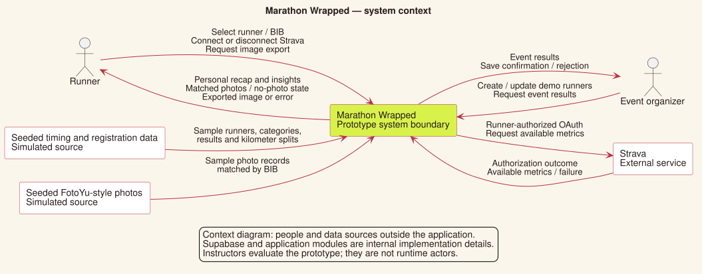
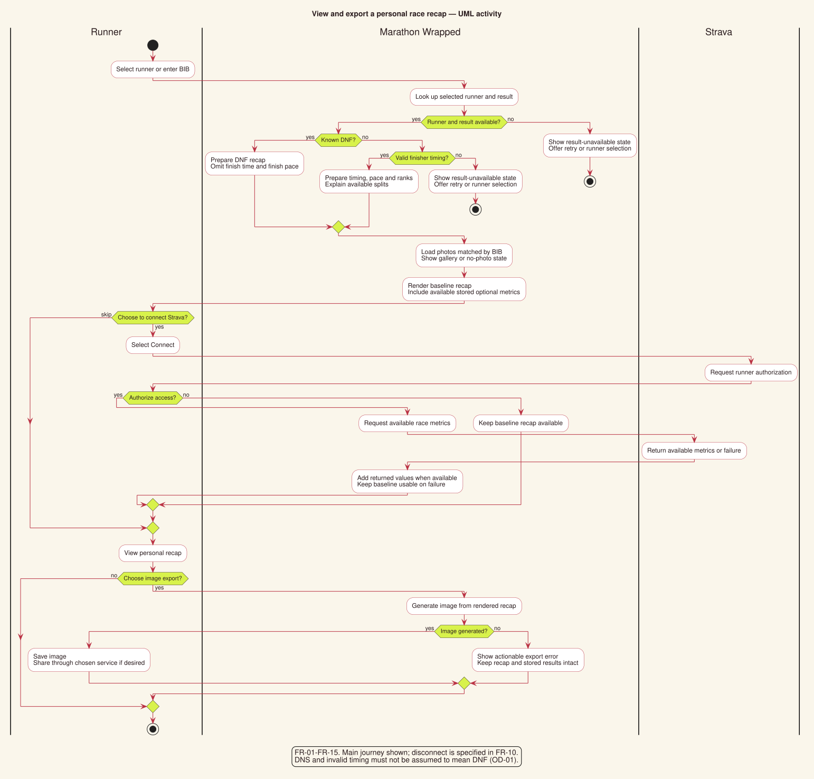
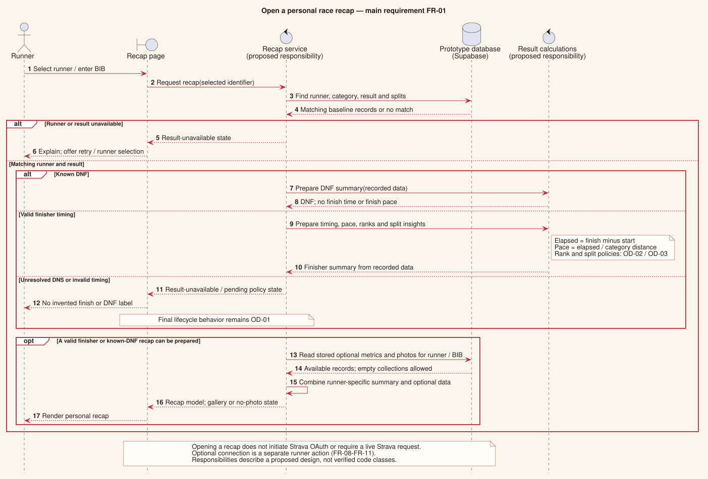
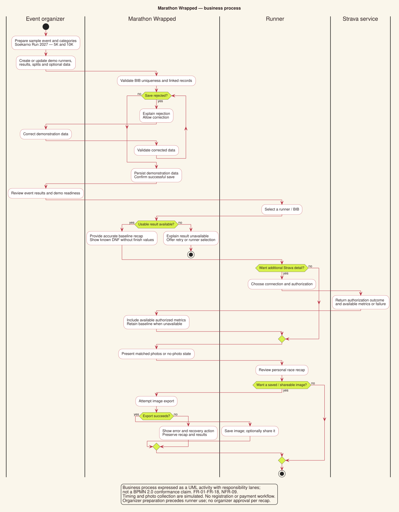
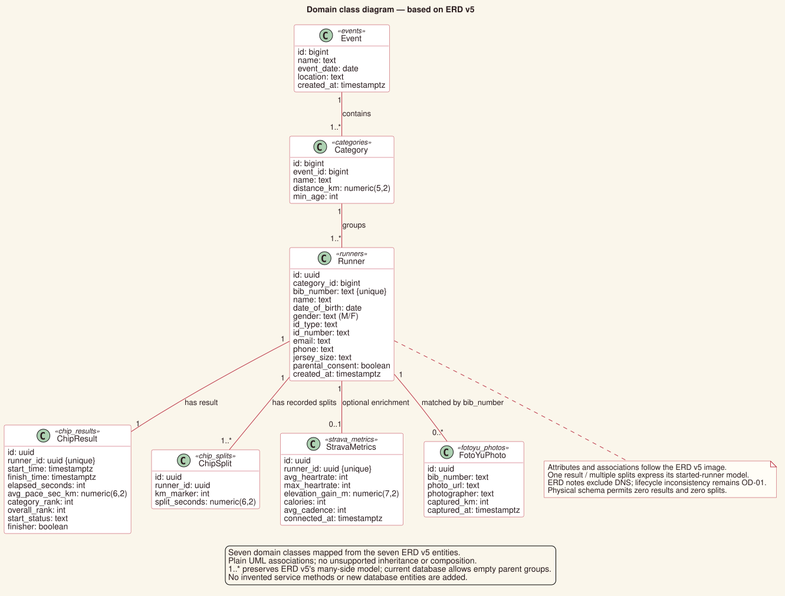

# Software Requirements Specification V4
## Marathon Wrapped

**Version:** 4.0  
**Date:** October 23, 2026  
**Status:** Draft for team review  
**Course:** Software Engineering — Sampoerna University × University of Arizona  
**Demo event:** Soekarno Run 2027  
**Baseline:** [SRS V3](SRS_v3.md)

## 1. Purpose and scope

Marathon Wrapped helps a runner understand and remember their race through a personal recap that they can save and share as an image. It brings race results, performance insights, optional Strava metrics, and matched race photos into one experience.

The course prototype covers one event, Soekarno Run 2027, with 5K and 10K categories. Runners view their recap. Organizers view event results and maintain demonstration runners.

Timing results and race photos use seeded sample data. Photos are matched by BIB number in a simulated FotoYu-style gallery. Strava uses a real, voluntary OAuth connection and its V3 API. Seeded Strava examples used for demonstrations must be identified as sample data.

This revision simplifies the document structure and wording. It does not establish that the application already satisfies these requirements or that the team has approved unresolved decisions.

### Reading the requirements

**Shall** means required. **Should** means recommended. Connecting Strava is the runner's choice; supporting that choice is a required system feature.

Sections 3 and 4 describe user needs and testable behavior together, avoiding separate copies of the same requirement. Section 8 preserves links to V3 IDs. V4 IDs apply to this document; existing V3 IDs remain available for historical references.

## 2. Stakeholders

| Stakeholder | What they need | Relationship to the system |
| --- | --- | --- |
| Runner | An accurate, understandable personal recap, their matched photos, control over Strava connection, and an image they can save or share. | Primary user. |
| Event organizer | A view of event results and a way to maintain reliable demonstration data. | Primary user with organizer functions. |
| Project team | A clear, achievable scope and requirements that can guide development, documentation, and testing. | Builds and verifies the prototype. |
| Course instructors and graders | A working demonstration and evidence that the project meets its stated requirements. | Reviews and evaluates the deliverables. |

Strava is an external service dependency. FotoYu represents a simulated photo source in this prototype; it is not a live integration.

## 3. Functional requirements

Each row states the expected behavior and a practical way to check it.

### Runner recap

| ID | Requirement | Acceptance check |
| --- | --- | --- |
| FR-01 | The system shall open a recap for the selected runner using their unique identifier or BIB. All displayed results, metrics, and photos shall belong to that runner. | Switch between two runners and verify each recap against its source records. |
| FR-02 | For a finisher, the recap shall show finish time, average pace, category rank, overall rank, and per-kilometer splits. | Compare all five information types with a seeded finisher's records and calculations. Overall-rank scope remains a decision in section 7. |
| FR-03 | The system shall calculate elapsed time from finish time minus start time, and average pace from elapsed seconds divided by category distance in kilometers. | A 10K runner with 3,000 elapsed seconds has a pace of 300 seconds per kilometer, displayed as 5:00/km. |
| FR-04 | The system shall calculate category and overall ranks from valid finisher elapsed times in ascending order and exclude DNF runners. | Compare ranks with sorted finisher records. Tie handling and overall comparison scope must be agreed before final acceptance. |
| FR-05 | The system shall use recorded per-kilometer splits to identify the fastest kilometer and explain whether later portions were faster or slower than earlier portions. | Check the fastest kilometer against the lowest split time. Check the comparison against the rule agreed under OD-03. Do not invent missing splits. |
| FR-06 | A runner marked DNF shall receive a usable recap showing DNF without a fabricated finish time or finish pace. A started runner without a valid finish shall not receive a calculated finish pace. | Open the seeded DNF example and verify the status, omitted finish values, and exclusion from finisher rankings. Missing results and DNS require separate treatment under OD-01. |
| FR-07 | If the requested runner or result is unavailable, the system shall show a result-unavailable message and an action to retry or return to runner selection. | Request an unknown identifier and a known runner without a result. Verify that neither case displays another runner's data. |

### Optional Strava connection

| ID | Requirement | Acceptance check |
| --- | --- | --- |
| FR-08 | A runner shall be able to connect Strava through OAuth 2.0 after explicitly selecting Connect and authorizing access. | Opening the recap does not start OAuth. Selecting Connect begins authorization; connection requires consent. |
| FR-09 | After a successful connection, the system shall retrieve and display available average heart rate, maximum heart rate, elevation gain, calories, and average cadence for the selected runner. | Test complete and incomplete metric responses. Display returned values only; do not invent missing metrics. Activity selection remains OD-05. |
| FR-10 | A runner shall be able to disconnect Strava. The system shall remove or invalidate the associated connection data and stop displaying metrics as connected data while keeping baseline results available. | Disconnect and refresh. Verify the disconnected state and intact chip results. Failed disconnection must not be reported as success. Retention and recovery details remain OD-05. |
| FR-11 | Skipping or denying Strava authorization, a failed request, and unavailable or incomplete Strava data shall not block the baseline recap. | Exercise each condition and verify the runner can still view available baseline results and insights. |

### Race photos and image export

| ID | Requirement | Acceptance check |
| --- | --- | --- |
| FR-12 | The system shall match sample race photos by the runner's unique BIB and display all available matching photo records. | Open a runner with multiple photos and confirm all returned matches belong to that BIB. |
| FR-13 | When no photos match, the system shall show a no-photo state and keep the remaining recap usable. | Open a runner with zero photo records. Verify the message and baseline recap. |
| FR-14 | A runner shall be able to export their rendered recap as an image that they can save and share. | Export two runners and inspect the images for the correct runner and rendered content. Strava and photos are not prerequisites. Format and dimensions remain OD-06. |
| FR-15 | If export fails, the system shall show an actionable error while preserving the recap and stored results. | Force an export failure and verify a correction or retry action and unchanged result data. |

Sharing means the runner can use the exported image with their chosen service. Automatic social posting is outside scope.

### Organizer functions

| ID | Requirement | Acceptance check |
| --- | --- | --- |
| FR-16 | An organizer shall be able to view results for all seeded runners in the prototype event, including DNF runners. | Compare the organizer view with the complete Soekarno Run 2027 dataset. |
| FR-17 | An organizer shall be able to create and update hero-runner demonstration data through the supported management interface without changing source code. | Create and update a demonstration runner and linked records, reload, and verify persistence. Replacement behavior remains OD-07. |
| FR-18 | When a save is rejected, the organizer interface shall explain the reason and allow correction. It shall report success only after a successful save. | Attempt a duplicate BIB, an invalid relationship, and a failed save. Verify rejection feedback and a correction path. |

## 4. Quality requirements

| ID | Requirement | Acceptance check |
| --- | --- | --- |
| NFR-01 | A seeded recap shall become usable within 3 seconds in at least 19 of 20 consecutive page loads under the agreed test conditions. | Record the dataset, connection, environment, usable-state definition, and all 20 measurements. Conditions remain OD-08. |
| NFR-02 | A single recap load shall avoid redundant identical runner-data requests unless there is a documented reason. | Inspect a request trace for unnecessary repeated requests. |
| NFR-03 | Missing Strava data, missing photos, and DNF data shall each leave a usable recap without requiring a page-wide application restart. | Keep at least one repeatable test for each of the three conditions. |
| NFR-04 | The recap and core actions shall be readable and usable at the mobile and desktop sizes and in the browsers selected by QA. | Record browser versions and viewport sizes; test viewing, connecting, photos, and export in each supported environment. |
| NFR-05 | The runner shall reach the recap, Strava connection, photo gallery, and export action within three navigation steps from their relevant starting screens. | Agree starting screens under OD-08 and count transitions to each action. |
| NFR-06 | Strava credentials and access tokens shall not appear in runner-facing content or exported images. | Inspect the recap and exported image for exposed credentials. |
| NFR-07 | Organizer-only functions shall not be offered as runner actions. | Review runner screens. This interface separation does not establish authentication; access enforcement remains OD-04. |
| NFR-08 | Required services shall operate within their applicable free-tier limits during the demonstration. | Record applicable allowances and expected demonstration usage. |
| NFR-09 | The demonstration dataset shall contain at least three complete hero runners with chip results, sample Strava metrics, and matched photos, plus at least one example each of DNF, no Strava data, and no photos. | Audit seed records and open the complete and edge-case examples. |

### Recommended presentation

The recap should explain pace, split, cadence, and DNF in everyday language. The Strava prompt should explain that connection is optional and the baseline recap is already available. Skipped, denied, or unavailable connections should include a brief explanation; successful disconnection should include confirmation.

The interface should use the approved project palette: red `#BA3143`, cream `#FAF6EB`, lime `#D8F24B`, and dark text `#291B1D`, with readable contrast.

## 5. Data and business rules

### Required and optional information

| Information | Source | Rule |
| --- | --- | --- |
| Event and category | Seeded event data | One event with 5K and 10K categories. Each runner belongs to one category. |
| Runner identity | Seeded registration records | Unique, non-transferable BIB; ordinary updates shall not change an assigned BIB. |
| Timing result | Simulated chip data | At most one result per runner; each seeded demonstration runner is expected to have a result. Missing results remain a distinct state. |
| Kilometer splits | Simulated chip data | Each seeded finisher shall have exactly one split for every kilometer marker from 1 to their category distance. |
| Strava metrics | Authorized API response or labeled demonstration records | Optional; at most one active stored metrics record per runner. |
| Photos | Seeded FotoYu-style records | Optional; zero or more records matched by BIB. |

The database shall enforce BIB uniqueness, result and metrics uniqueness per runner, and foreign-key relationships that reject orphaned result, split, metric, and photo records. Demonstration metrics are sample data and do not demonstrate live authorization.

### Registration source records

Registration is a source of prototype data, not a new registration workflow. V3's source fields remain: full legal name, date of birth, gender (M/F in the source model), email, phone, ID type and number, category, jersey size, parental consent, and BIB.

Retained source rules are:

- Minimum age: 13 for 5K and 17 for 10K.
- Parental consent for runners under 17.
- Name, gender, and jersey size become fixed after registration closes.
- Accepted ID types: KTP, SIM, Passport, KK, KITAS, and Student ID.
- Jersey sizes: S–XXL; BIB is assigned after registration and is non-transferable.

These are retained project assumptions from V3, not newly verified event policies.

The main entities remain events, categories, runners, chip results, chip splits, Strava metrics, and photo records. Physical fields are defined in [the schema migration](../supabase/migrations/20261019155810_initial_schema.sql). See also [data requirements](DATA_REQUIREMENTS.md) and [ERD](erd.md).

## 6. Main user flows

### Runner

1. Select a runner or supply the supported identifier/BIB.
2. View a finisher recap, DNF recap, or result-unavailable message.
3. Optionally connect Strava and view available additional metrics.
4. View matched photos, or a no-photo message.
5. Export the recap image to save or share.

Disconnecting Strava returns the runner to baseline results. Missing optional information does not block viewing or export.

### Organizer

1. Open the organizer results view.
2. Inspect seeded event results.
3. Create or update a demonstration runner and linked data.
4. Correct rejected input, or receive confirmation after a successful save.

Runner identification, organizer access enforcement, and replacement rules remain decisions below.

### System and process diagrams

These five diagrams support the requirements above. Editable PlantUML sources and rendered SVGs are kept in [the V4 diagram folder](diagrams/v4/README.md).

#### Context diagram

The context diagram shows the application boundary, its users, the real Strava dependency, and simulated data sources.

#### Activity diagram

The activity diagram expands the runner journey, including unavailable results, DNF, optional Strava, missing photos, and image-export failure (FR-01–FR-15).

#### Sequence diagram for viewing a recap

The main requirement is FR-01: open the selected runner's personal recap. This sequence shows proposed interactions between the page, recap responsibility, result calculations, and database. These responsibilities are a design proposal, not a claim about existing code classes. Live Strava authorization is a separate action.

#### Business process diagram

This process shows how organizer preparation supports the runner's recap and optional image sharing. Responsibility lanes distinguish organizer, application, runner, and Strava. It uses UML activity notation rather than claiming BPMN 2.0 compliance.

#### Class diagram based on ERD v5

The class diagram maps all seven entities, attributes, identifier types, and associations from [ERD v5](erd-v5.png). It keeps v5's one-result and many-splits multiplicities for its started-runner model, plus optional Strava and photos. The current database permits zero results or splits, so this conceptual model does not resolve OD-01. Event/category many-side multiplicities follow v5; physical tables can also have empty groups. No inheritance, composition, or unsupported entity is introduced.

## 7. Decisions still needed

These are inherited from V3. Simplifying the document does not make them agreed decisions.

| ID | Decision | Owner |
| --- | --- | --- |
| OD-01 | Distinguish DNF, did not start (DNS), missing result, and invalid timing. Confirm result lifecycle and handling of invalid timestamps. | Bella / Rakha / Embun |
| OD-02 | Define tied ranks and whether overall ranking compares both race distances or stays within a distance. | Bella / Embun |
| OD-03 | Define early/later split comparison for 5K and 10K, equal splits, rounding, tied fastest kilometers, and insufficient split data. | Embun / Harry / Shaun |
| OD-04 | Define how a runner is identified and how organizer access is enforced. | Bella / Rakha |
| OD-05 | Define race-activity selection in Strava, connection/metrics retention after disconnect, and recovery after failed disconnection. | Embun / Bella |
| OD-06 | Define export format/dimensions, broken-photo behavior, and error/retry wording. | Indra / Harry / Shaun |
| OD-07 | Define replacing hero runners and saving related records together so partial failures do not leave incomplete data. | Rakha / Bella |
| OD-08 | Agree performance conditions, usable-state measurement, browser versions, viewport sizes, and navigation-test starting screens. | Shaun / Bella |

Affected acceptance checks remain pending until their decisions are recorded.

## 8. Links to V3 requirements

This compact mapping preserves the origin of V4 requirements. Lettered V3 clauses are included under their parent IDs. This mapping records coverage; it does not claim implementation or approval.

| V4 section or ID | V3 source |
| --- | --- |
| FR-01–FR-07 | UR-F1, UR-F2, UR-F7; SR-F1–SR-F7, SR-F16–SR-F17, SR-F23 |
| FR-08–FR-11 | UR-F3–UR-F4; SR-F8–SR-F12; SR-NF12 |
| FR-12–FR-13 | UR-F5; SR-F13–SR-F15 |
| FR-14–FR-15 | UR-F6; SR-F18–SR-F19 |
| FR-16–FR-18 | UR-F8–UR-F9; SR-F20–SR-F21, SR-F24 |
| NFR-01–NFR-02 | UR-NF3; SR-NF1–SR-NF2 |
| NFR-03 | UR-NF2; SR-NF3–SR-NF7 |
| NFR-04–NFR-05 | UR-NF1; SR-NF15–SR-NF17 |
| NFR-06–NFR-07 | SR-NF13–SR-NF14 |
| NFR-08 | UR-NF5; SR-NF18 |
| NFR-09 | SR-F22; SR-NF19 |
| Recommended presentation | UR-D1–UR-D3; SR-D1–SR-D2 |
| Data and business rules | UR-NF4; SR-F4, SR-F10; SR-NF8–SR-NF11; V3 section 3 |
| Main user flows | V3 FS-01–FS-08, consolidated with section 3 |
| Decisions still needed | V3 OD-01–OD-08 |

V3's structured function forms and older diagrams remain available in [SRS V3](SRS_v3.md) as historical supporting detail. Section 6 contains the new V4 diagrams; the domain class diagram specifically follows ERD v5.

## 9. Delivery and review

### Technology and constraints

The selected stack remains Next.js, Tailwind CSS, Next.js API routes, Supabase Postgres and Storage, Strava V3 API, and Vercel. Figma supports design work. API availability and applicable free-tier allowances remain dependencies to verify before the demonstration.

Outside scope: real RFID/GPS hardware, live race-day collection, real payment or registration gateways, facial recognition, additional race categories, multiple events or organizations, automatic social posting, a personalized-link service, and hydration tracking.

### Responsibilities

| Member | Responsibility |
| --- | --- |
| Bella | Requirements, scope, planning, demos, integration, data contract, and risk log. |
| Rakha | Schema, seed data, and hero runners. |
| Embun | Calculations, rankings, and combining timing, Strava, and photo data. |
| Indra | Recap interface, gallery, and export. |
| Harry | Sample content, explanations, SRS, and report. |
| Shaun | Testing, edge cases, and acceptance evidence. |

### Retained delivery schedule

| Phase | Dates in 2026 | Goal |
| --- | --- | --- |
| Sprint 1 | Sep 22–Oct 18 | Data contract, schema, seeds, and baseline recap. |
| Sprint 2 | Oct 19–Nov 13 | Photos, optional Strava, and export. |
| Sprint 3 | Nov 14–Dec 4 | Visual improvements, hero runners, and report draft. |
| Project closing | Dec 5–Dec 10 | Final fixes and rehearsal; report Dec 8; demo Dec 10. |

These dates carry forward the plan and do not report completed work.

Before accepting V4, the team should review validity, consistency, completeness, realism, and verifiability; resolve the relevant open decisions; and record test evidence against the acceptance checks. Update the [requirements register](requirements-register.md) and [validation record](SRS_VALIDATION.md) when V4 is agreed. Until that migration, their V3 references remain historical references.

## 10. Glossary

| Term | Meaning |
| --- | --- |
| Wrapped | A runner's personal race recap. |
| BIB | The race number assigned to a runner. |
| Pace | Time taken per kilometer. |
| Split | Time for one part of a race; here, one kilometer. |
| DNF | Did not finish. |
| DNS | Did not start; behavior still needs agreement. |
| Cadence | Running step rate; units must follow the selected Strava field. |
| Hero runner | A sample runner with complete demonstration data. |
| Seeded data | Sample records prepared for the prototype. |
| OAuth | The process through which a runner authorizes Strava access. |

**References:** [SRS V3](SRS_v3.md), [requirements engineering lecture notes](lecture-notes/2026-10-01-requirements-engineering.md), [data requirements](DATA_REQUIREMENTS.md), and [ERD](erd.md).

