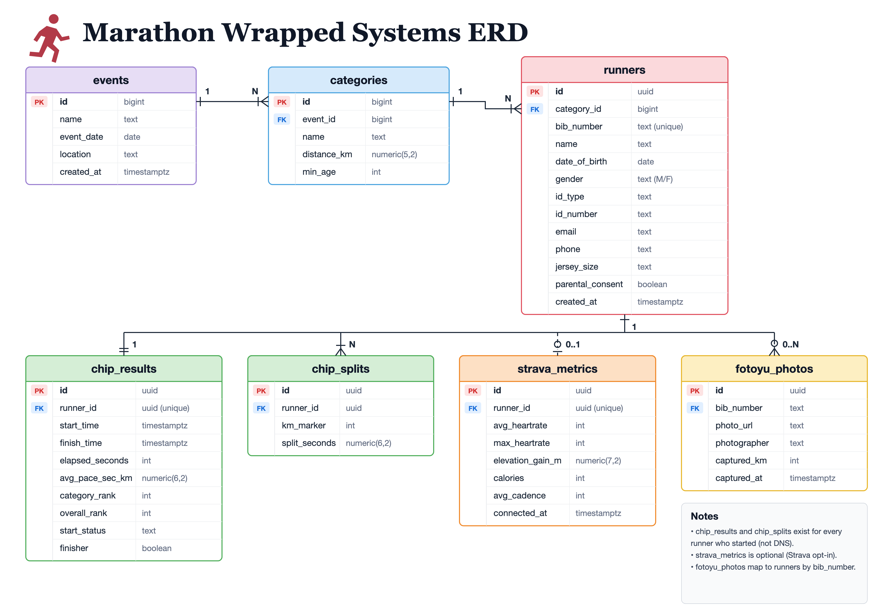

# Entity Relationship Diagram (ERD) — v5

Owner: **Bella** · Issue 03 · **Version 5** (Sep 25, 2026)

## Relationships

| # | Relationship | Cardinality |
|---|---|---|
| 1 | An **event** has many **categories** | 1 : N |
| 2 | A **category** has many **runners** | 1 : N |
| 3 | A **runner** has one **chip_results** row (mandatory) | 1 : 1 |
| 4 | A **runner** has many **chip_splits** rows (one per km) | 1 : N |
| 5 | A **runner** may have one **strava_metrics** row (only if they connect Strava) | 1 : 0..1 |
| 6 | A **runner** may have many **fotoyu_photos** (mapped by `bib_number`) | 1 : 0..N |

## Notes

- `chip_results` and `chip_splits` exist for every runner who started (not DNS).
- `strava_metrics` is optional and only created if the runner connects their Strava account.
- `fotoyu_photos` are manually mapped to the runner's `bib_number`.

## Schema alignment

v5 matches `db/schema.sql` (the source of truth) — every table, column and type. When the schema changes, update the diagram as a new version.

## Version history

| Version | Image | Changes |
|---|---|---|
| v5 | [`erd-v5.png`](erd-v5.png) | `id` of `runners`, `chip_results`, `chip_splits`, `strava_metrics` and `fotoyu_photos` changed from `bigint` to `uuid`, plus every `runner_id` FK (requested by Rakhansyah). `events` and `categories` keep `bigint`. runner → `fotoyu_photos` shown as 0..N (optional); notes say chip data exists for runners who started (not DNS). |
| v4 | [`erd-v4.png`](erd-v4.png) | Added `runners.id_type` and `runners.id_number` — ERD matches `db/schema.sql`. |
| v3 | [`erd-v3.png`](erd-v3.png) | Aligned with `db/schema.sql`: `categories.min_age`; `runners.date_of_birth` (replaces `age`), gender `M/F`, `email`, `phone`, `jersey_size`, `parental_consent`; `chip_results.start_status`; `(unique)` labels restored; `fotoyu_photos` now keyed by `bib_number` with `photo_url`, `photographer`, `captured_km`, `captured_at`. |
| v2 | [`erd-v2.png`](erd-v2.png) | Diagram only — legend and key-relationships panel removed. `gender` and `bib_number` shown as plain `text`; `(unique)` labels dropped from `runners.bib_number`, `chip_results.runner_id` and `strava_metrics.runner_id`. |
| v1 | [`erd-v1.png`](erd-v1.png) | First version, with relationship legend and key-relationships panel. |

See also: [`DATA_REQUIREMENTS.md`](DATA_REQUIREMENTS.md) §3–4 and [`SRS.md`](SRS.md) §3.3–3.4.
