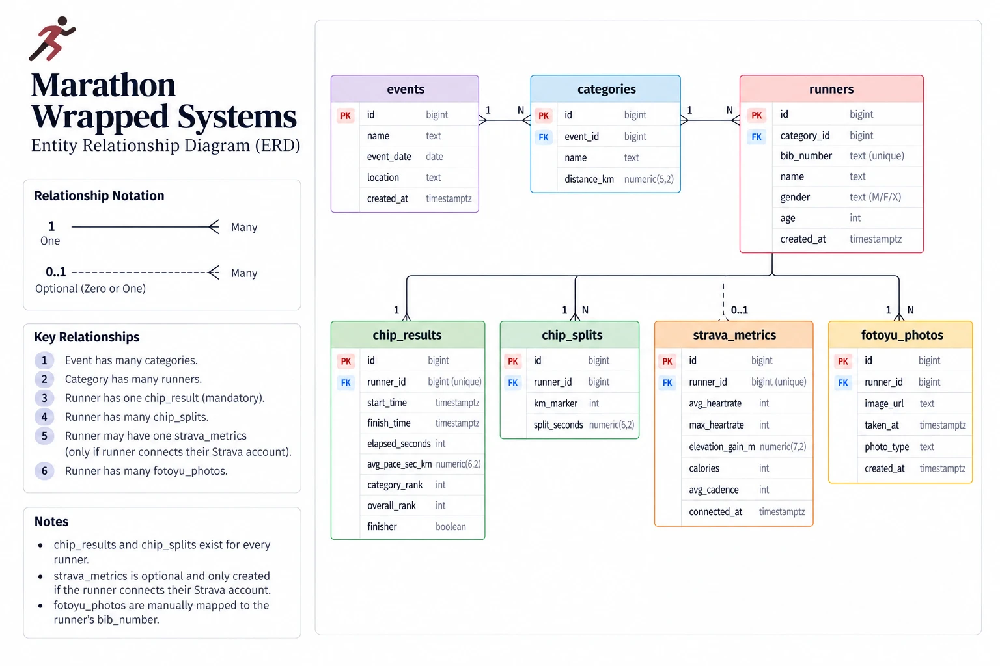

# Entity Relationship Diagram (ERD) — v1

Owner: **Bella** · Issue 03 · **Version 1** (Sep 24, 2026)

## Relationships

| # | Relationship | Cardinality |
|---|---|---|
| 1 | An **event** has many **categories** | 1 : N |
| 2 | A **category** has many **runners** | 1 : N |
| 3 | A **runner** has one **chip_results** row (mandatory) | 1 : 1 |
| 4 | A **runner** has many **chip_splits** rows (one per km) | 1 : N |
| 5 | A **runner** may have one **strava_metrics** row (only if they connect Strava) | 1 : 0..1 |
| 6 | A **runner** has many **fotoyu_photos** (mapped by `bib_number`) | 1 : N |

## Notes

- `chip_results` and `chip_splits` exist for every runner.
- `strava_metrics` is optional and only created if the runner connects their Strava account.
- `fotoyu_photos` are manually mapped to the runner's `bib_number`.

## Differences from `db/schema.sql` (to fix in v2)

The diagram shows the core entities. The schema (source of truth) has these differences — update one or the other so they match:

| Table | Diagram | `db/schema.sql` |
|---|---|---|
| `categories` | — | adds `min_age` |
| `runners` | `age`, gender `M/F/X` | `date_of_birth` (age computed), gender `M/F`, plus `email`, `phone`, `id_type`, `id_number`, `jersey_size`, `parental_consent` |
| `chip_results` | — | adds `start_status` (`on-time` / `late` / `dns`) |
| `fotoyu_photos` | FK `runner_id`; `image_url`, `taken_at`, `photo_type`, `created_at` | FK `bib_number`; `photo_url`, `photographer`, `captured_km`, `captured_at` |

See also: [`DATA_REQUIREMENTS.md`](DATA_REQUIREMENTS.md) §3–4 and [`SRS.md`](SRS.md) §3.3–3.4.
