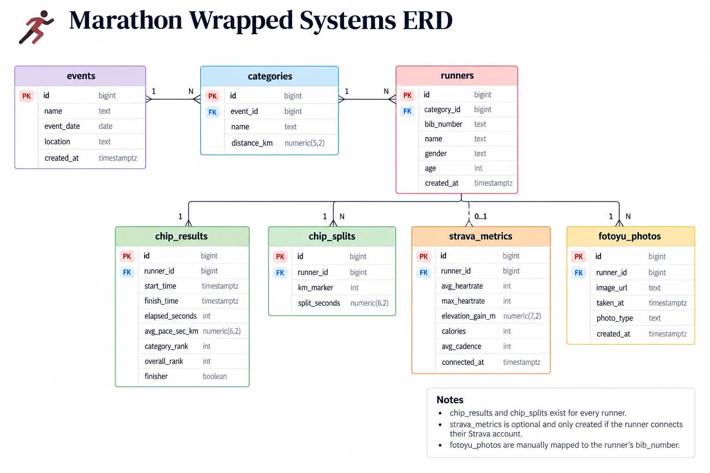

# Entity Relationship Diagram (ERD) — v2

Owner: **Bella** · Issue 03 · **Version 2** (Sep 24, 2026)

## Relationships

| # | Relationship | Cardinality |
|---|---|---|
| 1 | An **event** has many **categories** | 1 : N |
| 2 | A **category** has many **runners** | 1 : N |
| 3 | A **runner** has one **chip_results** row (mandatory) | 1 : 1 |
| 4 | A **runner** has many **chip_splits** rows (one per km) | 1 : N |
| 5 | A **runner** may have one **strava_metrics** row (only if they connect Strava) | 1 : 0..1 |
| 6 | A **runner** has many **fotoyu_photos** (mapped by `bib_number`) | 1 : N |

## Notes

- `chip_results` and `chip_splits` exist for every runner.
- `strava_metrics` is optional and only created if the runner connects their Strava account.
- `fotoyu_photos` are manually mapped to the runner's `bib_number`.

## Differences from `db/schema.sql`

The diagram shows the core entities. The schema (source of truth) has these differences — update one or the other so they match:

| Table | Diagram (v2) | `db/schema.sql` |
|---|---|---|
| `categories` | — | adds `min_age` |
| `runners` | `age` | `date_of_birth` (age computed), gender `M/F`, `bib_number` unique, plus `email`, `phone`, `id_type`, `id_number`, `jersey_size`, `parental_consent` |
| `chip_results` | — | `runner_id` unique; adds `start_status` (`on-time` / `late` / `dns`) |
| `strava_metrics` | — | `runner_id` unique |
| `fotoyu_photos` | FK `runner_id`; `image_url`, `taken_at`, `photo_type`, `created_at` | FK `bib_number`; `photo_url`, `photographer`, `captured_km`, `captured_at` |

## Version history

| Version | Image | Changes |
|---|---|---|
| v2 | [`erd-v2.png`](erd-v2.png) | Diagram only — legend and key-relationships panel removed. `gender` and `bib_number` shown as plain `text`; `(unique)` labels dropped from `runners.bib_number`, `chip_results.runner_id` and `strava_metrics.runner_id`. |
| v1 | [`erd-v1.png`](erd-v1.png) | First version, with relationship legend and key-relationships panel. |

See also: [`DATA_REQUIREMENTS.md`](DATA_REQUIREMENTS.md) §3–4 and [`SRS.md`](SRS.md) §3.3–3.4.
